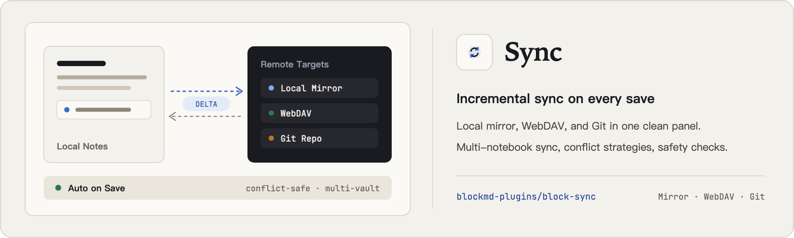

<picture>
  <source media="(prefers-color-scheme: dark)" srcset="assets/card-en-dark.png">
  <source media="(prefers-color-scheme: light)" srcset="assets/card-en-light.png">
  
</picture>

- **Three backends**: Sync multiple notebooks over Local Mirror, WebDAV, or Git.
- **Auto on save**: Incremental sync runs automatically on save, plus one-click Sync Now.
- **Conflict-safe**: Choose conflict copy, local-first, or remote-first with destructive guardrails. With deletion protection enabled, confirm before uploading a note that was deleted remotely.
- **Sync alerts** — Get an alert when sync fails, encounters a conflict, or needs approval. Block uses an in-app alert in the foreground and a system notification in the background. If delivery fails, Sync retries on a later system event. You can turn alerts off in sync settings.
- **Resume sync** — With automatic sync enabled, sync runs after the computer wakes or reconnects, using the existing safety checks.
- **Git pushes** — Sync pushes commits it can identify as its own. Review and handle any other unpushed commits in Git before retrying sync.
- **Local Git worktrees** — Switch to the configured branch before syncing. If the remote branch can be fast-forwarded, confirm the worktree update before continuing notebook sync.
- **System credentials** — Git tokens and WebDAV passwords go in the system credential store. Existing credentials migrate after a verified write. Migration retries if the store is locked. Replace or clear old credentials that exceed 1536 bytes or contain NUL characters. Re-enter credentials when changing the server, WebDAV username, or Git repository. Clear Credential applies to settings for the current destination and account. Linux uses Secret Service.

**Install**: Open Block Settings -> App Store and search **Sync**, or enter `blockmd-plugins/block-sync`.

Older Block versions can install the compatible version from the App Store or use the [v1.3.44 release package](https://github.com/blockmd-plugins/block-sync/releases/tag/v1.3.44). Upgrade Block to use notifications, system credentials, and resume sync.
