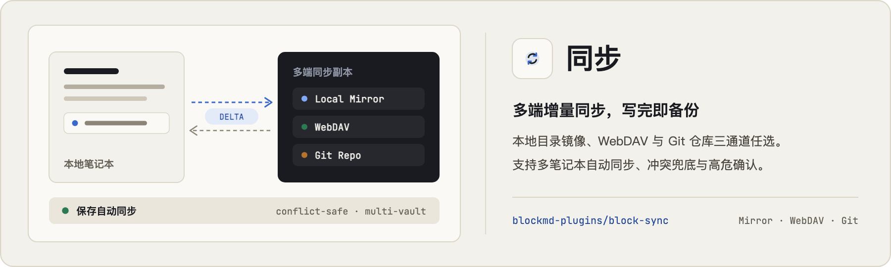

<picture>
  <source media="(prefers-color-scheme: dark)" srcset="assets/card-zh-dark.png">
  <source media="(prefers-color-scheme: light)" srcset="assets/card-zh-light.png">
  
</picture>

想让多台设备像 Obsidian Sync 或坚果云一样随时看到最新笔记，又不想额外买官方同步会员？这款插件可以把笔记自动同步到你自己的云盘文件夹（如 iCloud、Dropbox、OneDrive）、WebDAV 网盘（坚果云、群晖等）或 GitHub/Git 仓库，数据完全留在你自己手里。

- **三种方式一起用，多笔记本同时管**：支持本地云盘目录、WebDAV 网盘和 Git 仓库三种同步方式，可以同时开启、各自显示同步进度，也能同时管理多个笔记本。
- **保存即同步，定时与唤醒也会补**：写完一保存就自动同步改动，也可随时点「立即同步」；开启自动同步后按 5 分钟、30 分钟或 1 小时定时检查，电脑休眠唤醒或重新联网后还会自动补同步。
- **冲突自动留副本，误删随时能找回**：支持冲突保留副本、优先本地或优先远端。在任意一端删除笔记后另一端会同步清理，但本地文件会进系统回收站，WebDAV 和本地同步目录有专门恢复区，Git 会保留历史提交；大批量删除或重传已删笔记前都会先确认。
- **异常及时提醒，密码存系统钥匙串**：遇到同步失败、冲突或需要确认时，前台弹窗、后台发系统通知及时提醒；WebDAV 密码和 Git 令牌直接加密保存在系统钥匙串里。（如果同一个 Git 仓库也在其他地方手动提交过修改，同步前先合并好分支即可。）

**安装**：打开 Block「设置 → 应用商店」搜索 **同步**，或手动填入 `blockmd-plugins/block-sync`。

旧版 Block 可在应用商店安装兼容版本，或手动安装 [v1.3.44 归档](https://github.com/blockmd-plugins/block-sync/releases/download/v1.3.44/block-sync-v1.3.44.tar.gz)；升级新版 Block 后可使用系统通知、钥匙串与唤醒补同步。
